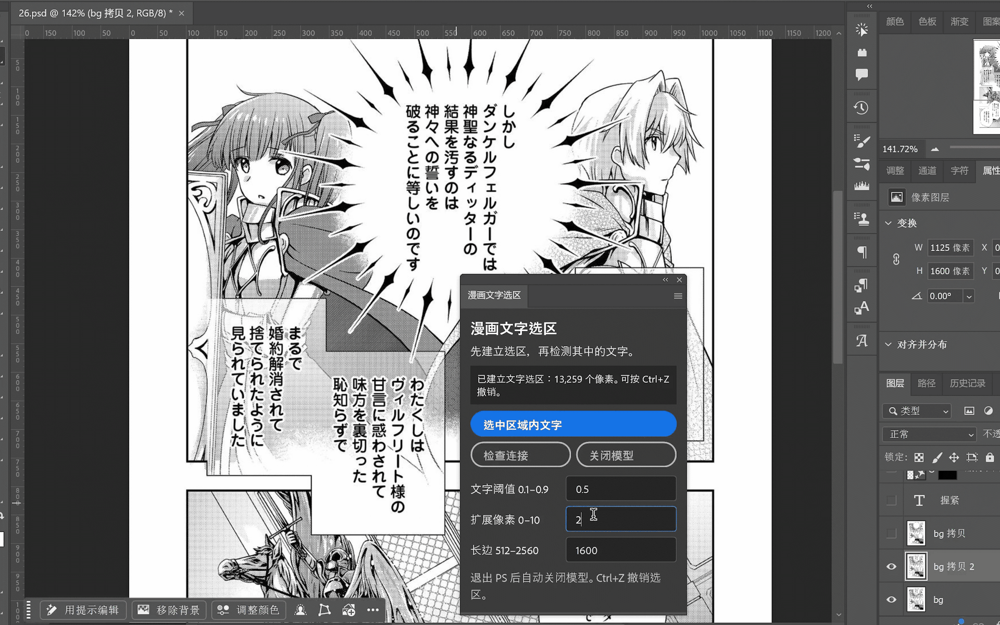
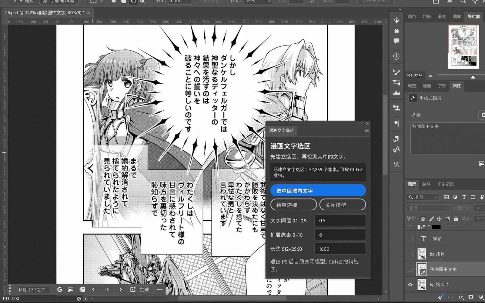

# 漫画文字选区助手 · Photoshop 插件

> PS 面板名称：**漫画文字选区** · Manga Text Selection for Adobe Photoshop · Windows x64 · 本地 CPU 推理

## 为什么做这个插件

做这个插件的初衷，是让 Photoshop 的**创成式填充**用起来更方便。

用创成式填充去掉漫画里的文字时，最费时间的往往不是生成，而是**选区**：框得太大，AI 会连同背景、网点和线条一起重画；框得太小，文字边缘又会残留。手动用魔棒或套索一点点抠出每个字的笔画，既慢又难保证干净。

这个插件把这一步交给本机运行的漫画文字分割模型：你先随手用矩形或套索框住一片区域，点击“选中区域内文字”，插件就会把选区收窄到这片区域里的**文字笔画像素**。之后可以直接接上创成式填充，或者用它做蒙版，只替换文字所在的像素。

- 结果严格限制在你原来的选区内，保留套索形状和羽化。
- 只修改选区，不改动图片像素，可以 Ctrl+Z 撤销。
- 模型在本机运行，漫画图片不会上传；模型没开时会自动启动，退出 Photoshop 后自动关闭。
- 插件本身不做 OCR、翻译或背景修复；去字、补背景由 Photoshop 的创成式填充完成。

## 两种用法

> **注意：下面两段 GIF 都经过加速处理，创成式填充的实际处理时间没有演示里这么快。** 

### 方法 1：插件建立文字选区 → Firefly 直接移除文字

适合背景比较简单、想一步完成的场景。

1. 用矩形或套索框住要去字的区域。
2. 在插件面板点击“选中区域内文字”，得到只包含文字笔画的选区。可以把“扩展像素”调大一些，让选区盖住文字的描边和抗锯齿边缘。
3. 直接使用创成式填充，用 Adobe **Firefly** 模型移除选区里的文字。

### 方法 2：矩形选区 + 提示词让 Nano Banana 2 去字 → 插件建立文字选区做蒙版

适合背景复杂、网点和线条多，希望**最大程度保留原图**的场景。

1. 用矩形选框工具框住含文字的区域。
2. 使用创成式填充，输入提示词（例如“移除图中文字”），选择 **Nano Banana 2** 模型生成，得到一个去字后的生成图层。
3. 回到原图，用插件在同一区域点击“选中区域内文字”，建立文字选区。
4. 用这个文字选区给生成图层添加蒙版。

这样做的意义在于：AI 往往会顺带改动文字以外的网点、线条和人物细节，而蒙版只让文字笔画所在的像素采用生成结果，其余部分仍是原图，最大程度地保留原图内容。

## 下载与安装

前往 [Releases](https://github.com/Dryiceee/manga-text-selection-photoshop-plugin/releases/latest) 下载 `Manga-Text-Selection-v1.0.0.zip`：

1. 完整解压到较短的固定文件夹，例如 `D:\MangaText`。
2. 安装 Python 3.12 x64。
3. 双击 `01-安装部署.cmd`：自动下载模型权重并校验、创建独立环境、安装依赖，并生成绑定你电脑的插件安装包。看到“部署检查通过”后再继续。
4. 双击 `03-安装PS插件.cmd`，或安装新生成的 `.ccx`。
5. 在 Photoshop 中打开插件面板“漫画文字选区”，先建立选区，再点击“选中区域内文字”。

首次部署需要联网，请准备约 5 GB 可用空间。也可以把[让 agent 帮你部署](https://github.com/Dryiceee/manga-text-selection-photoshop-plugin/blob/main/教程/02-Agent部署提示词.md)里的提示词交给能操作电脑的 agent，由它代为部署。

| 项目 | 要求 |
| --- | --- |
| 系统 | Windows x64 |
| Photoshop | 25.0 或更高版本（创成式填充需要 Adobe 账号与相应额度，并需联网） |
| 推理 | CPU，无需独立显卡 |
| Python | 3.12 x64（部署时创建独立虚拟环境） |

## 参数

| 参数 | 默认值 | 说明 |
| --- | --- | --- |
| 文字阈值 | 0.5 | 漏选文字可试 0.4；把画面线条误选成文字可试 0.6。 |
| 扩展像素 | 2 | 配合创成式填充时可适当调大（如 4–6），盖住文字边缘；扩展后仍不超出原选区。 |
| 推理长边 | 1600 | 太慢可用 1024；小字漏检可试 2048。 |

## 文档

- [手动部署与使用](https://github.com/Dryiceee/manga-text-selection-photoshop-plugin/blob/main/教程/01-手动部署与使用.md)
- [让 agent 帮你部署](https://github.com/Dryiceee/manga-text-selection-photoshop-plugin/blob/main/教程/02-Agent部署提示词.md)
- [来源、版本与文件说明](https://github.com/Dryiceee/manga-text-selection-photoshop-plugin/blob/main/教程/03-来源与文件说明.md)

## 模型来源

文字分割模型来自原作者的 [a-b-c-x-y-z/Manga-Text-Segmentation-2025](https://huggingface.co/a-b-c-x-y-z/Manga-Text-Segmentation-2025)。本项目**不分发模型权重**，部署脚本会从原仓库的固定 revision 下载并校验 SHA256。模型及训练资料的权利归原作者及各自权利人，使用条件请查看原仓库说明。

Firefly 与 Nano Banana 2 是 Photoshop 创成式填充中可选的生成模型，不属于本插件；其使用条件以 Adobe 及模型提供方的规定为准。
